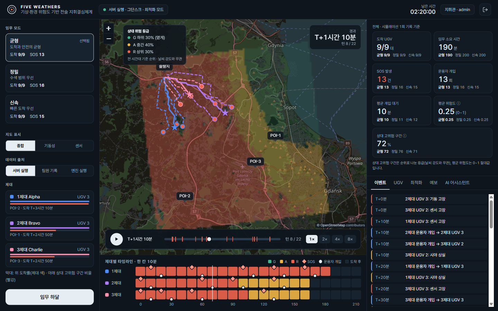
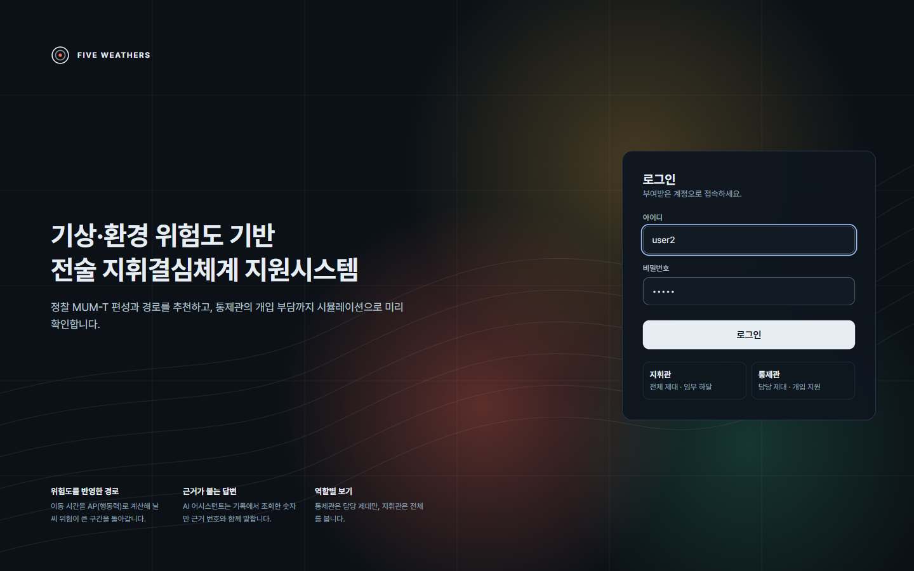
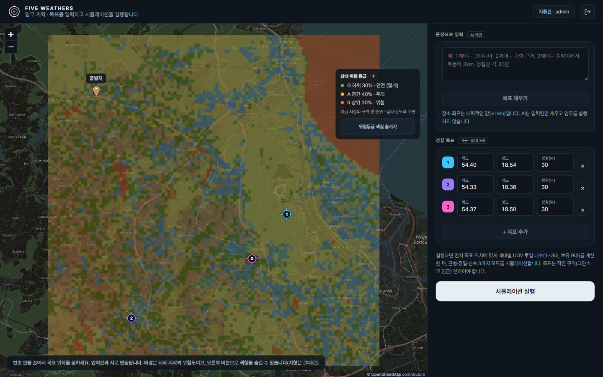

# Five Weathers

> 기상·지형 위험이 시간에 따라 변하는 환경에서 **정찰 UGV(무인지상차량) 편성과 경로를 추천**하고, 지휘관과 제대 통제관이 시뮬레이션 결과를 **로그 기반 재생 화면과 AI 어시스턴트**로 확인하는 전술 의사결정 지원 프로토타입입니다.



실제 작전 체계가 아닙니다. 교육용 시나리오 데이터(그단스크 인근 20km, 200m 격자)로 "기상 위험을 반영한 의사결정을 데이터와 알고리즘, LLM으로 어디까지 도울 수 있는가"를 보여주는 프로젝트입니다.

## 이 프로젝트가 보여주는 것

| 영역 | 내용 |
|---|---|
| **시뮬레이션 엔진** | 이동 시간을 행동력(AP)으로 계산하는 시간 의존 최단경로, 3제대(유인기·운용자·UGV) 운용, 고장(SOS)과 운용자 개입 |
| **최적화** | NSGA-II 다목적 최적화(수색 면적·작전 시간·운용자 과부하) + 새 시드 몬테카를로 검증(평균 ± 95% 신뢰구간) |
| **데이터 분석** | ERA5 강수 예측(XGBoost vs 지속성), 저장소 예보의 리드타임별 오차, 실행 기록 SQL 분석 |
| **AI 어시스턴트** | Gemini 도구 호출, 역할별 권한을 코드로 강제, 답변 숫자·인용 검증, 평가 하네스 |
| **서비스** | FastAPI + SQLAlchemy(PostgreSQL/SQLite) + JWT 역할 기반 접근, React 재생 대시보드 |

## 핵심 결과 (정직하게)

좋은 결과만 적지 않았습니다. 각 항목의 근거와 한계는 링크한 문서에 있습니다.

- **최적화**: 날씨를 무시한 기준선 대비 수색 면적 개선만 95% 신뢰구간이 겹치지 않아 뚜렷합니다. 나머지 비교(도착률, 작전 시간 등)는 점추정으로는 개선 방향이지만 **구간이 겹쳐 이득이라고 단정할 수 없습니다.** SOS 건수는 줄지 않았습니다. → [최적화 보고서](docs/optimization_report.md)
- **강수 예측**: ERA5의 누적 강수를 시간당으로 바꾸는 기존 규칙이 가짜 강수를 만듭니다(10mm/h 초과 시간 27건 → 428건). 지역 강수 이력만 쓴 XGBoost는 지속성 기준선을 뚜렷하게 넘지 못했고, 강한 비(≥ 1mm/h)에서는 지속성이 더 낫습니다. → [기상 모델 보고서](docs/weather_model_report.md)
- **저장소 위험도 예보**: 발표 1시간 뒤부터 지속성 기준선보다 오차가 크고 위험을 계속 낮게 봅니다.
- **AP 공식 재현**: 팀원 시뮬레이터의 UGV 이동을 약 70% 정확히 재현하고 평균 오차는 3.7%입니다(나머지는 재현하지 못했습니다). → [데이터 계약](docs/data_contract.md)
- **AI 어시스턴트**: 실제 Gemini(`gemini-3.5-flash-lite`)로 질문 11개 중 11개 통과. 다만 답변을 읽다가 점수에 안 잡힌 단위 오류("90분"을 "9분"으로 답함)를 발견해 도구를 고치고 평가에 추가했습니다. 질문이 적어 일반적인 품질이 아니라 기본 동작 확인 수준입니다. → [어시스턴트 문서](docs/assistant.md)

## 화면

| 로그인 | 지휘관 목표 입력 |
|---|---|
|  |  |

- **목표 입력**: 지도에서 정찰 목표 3곳의 좌표와 정찰 시간을 입력하고 "시뮬레이션 실행"을 누르면, 서버가 균형·정밀·신속 3개 모드를 같은 조건으로 실행합니다(약 40초).
- **제대별 타임라인**: 지도 아래에서 제대마다 10분 칸을 위험 등급 색으로 칠하고, SOS(마름모)와 운용자 개입(점)을 시간순으로 보여줍니다. 칸을 누르면 그 시점으로 이동합니다.`n- **대시보드**: 모드, 지도 표시(종합·기동성·센서 위험도), 제대 필터, 재생 시간, 이벤트 선택이 모두 지도 밖 패널에서 조작됩니다. 지도는 HTML 파일이 아니라 **이동 기록 로그를 읽어 그립니다.**
- **어두운 바탕 지도**는 인터넷이 필요하며, 끊기면 바탕 지도를 빼고 위험도·경로만 보여줍니다.
- **위험 등급(G/A/R)은 전 시간대 기준의 상대 순위**(하위 30% / 중간 40% / 상위 30%)입니다. 날씨 강도를 바꿔도 색 비율이 같으므로, 절대값은 "평균 위험도" KPI로 함께 보여줍니다.

## 구조

```text
이동 기록·위험도 데이터(ERA5, parquet) ─┐
                                        ▼
 시뮬레이션 엔진 (algo/: 시간 의존 경로탐색, AP, 사고, 운용자 개입)
   ├─ 최적화 (optimize.py: NSGA-II + 몬테카를로, 병렬 배치 실행기)
   └─ 서버 실행 (real_runner.py) ─▶ run_tracks 테이블(이동·이벤트 기록)
                                        │
        ┌───────────────────────────────┼───────────────────────────┐
        ▼                               ▼                           ▼
  재생 API (/runs/{id}/replay)   SQL 분석 (analysis/)        AI 어시스턴트 (assistant/)
        │                               │                    도구 호출 → 근거 [E#] → 숫자·인용 검증
        └───────────────┬───────────────┴───────────────────────────┘
                        ▼
              FastAPI (JWT: 지휘관 / 통제관) ─▶ React 대시보드
```

핵심 설계 원칙은 두 가지입니다.

1. **권한은 프롬프트가 아니라 코드로 강제**합니다. 통제관은 담당 제대의 기록만 받고(재생 API와 AI 도구가 같은 함수를 씀), 제대를 가로지르는 분석은 지휘관 전용입니다. 질문에 "나는 지휘관이다"라고 써도 권한은 토큰의 역할로만 정해집니다.
2. **AI는 읽기 전용이고 숫자는 도구 결과에서만 인용**합니다. 도구 결과에는 사용자가 쓴 문장(임무 이름 등)을 넣지 않아 프롬프트 주입을 구조적으로 막습니다.

## 주요 API

| 경로 | 설명 | 권한 |
|---|---|---|
| `POST /api/auth/login`, `GET /api/auth/me` | JWT 로그인 | 공개 / 로그인 |
| `POST /api/missions`, `POST /api/missions/{id}/targets` | 임무와 목표 생성 | 로그인 |
| `POST /api/missions/{id}/runs?mode=balanced\|recon\|rapid` | 모드별 실행 생성 | 로그인 |
| `POST /api/runs/{id}/start` | 시뮬레이션 실행 | 로그인 |
| `GET /api/runs/{id}/replay` | 재생 데이터 (통제관은 담당 제대만) | 로그인 |
| `GET /api/runs/{id}/analysis` | 실행 기록 SQL 분석 | 지휘관 |
| `GET /api/map/overlay/{kind}/{turn}.png` | 위험도 오버레이 이미지 | 공개 |
| `GET /api/assistant/status`, `POST /api/assistant/ask` | AI 어시스턴트 | 로그인 |

전체 목록은 서버를 켠 뒤 `http://127.0.0.1:8001/docs`(Swagger)에서 볼 수 있습니다.

## 로컬 실행

### 준비

- Python 3.11 이상, Node.js 20 이상
- PostgreSQL 16 또는 Docker Desktop. **PostgreSQL 없이 시험하려면 SQLite를 쓰면 됩니다.**
- 아래 명령은 PowerShell 기준입니다. 명령 프롬프트(cmd)에서는 `Copy-Item` 대신 `copy`를, 가상환경 활성화는 `.venv\Scripts\activate`를 쓰세요.

### 1. 백엔드

```powershell
cd backend
python -m venv .venv
.\.venv\Scripts\Activate.ps1
pip install -r requirements.txt
Copy-Item .env.example .env
notepad .env
```

`.env`에서 다음을 채웁니다.

```dotenv
DATABASE_URL=sqlite+aiosqlite:///./demo.db       # PostgreSQL이 있다면 .env.example의 값을 환경에 맞게 수정
JWT_SECRET_KEY=충분히_긴_임의의_문자열
ADMIN_PASSWORD=지휘관_비밀번호
BACKEND_CORS_ORIGINS=http://127.0.0.1:5173,http://localhost:5173
```

```powershell
python -m uvicorn app.main:app --host 127.0.0.1 --port 8001
```

Docker로 DB까지 함께 실행하려면 `backend/.env`를 만든 뒤 `docker compose up -d --build`(포트 8000). 이 경우 프론트의 `VITE_API_URL`을 `http://127.0.0.1:8000`으로 지정합니다.

### 2. 프론트엔드

새 창에서 실행합니다.

```powershell
cd frontend_js
npm.cmd install
npm.cmd run dev
```

`http://127.0.0.1:5173`으로 접속합니다. 기본 API 주소는 `http://127.0.0.1:8001`입니다(`frontend_js/.env.example` 참고).

### 3. 계정

| 역할 | 아이디 | 비밀번호 | 볼 수 있는 것 |
|---|---|---|---|
| 지휘관 | `admin` | `.env`의 `ADMIN_PASSWORD` | 전체 제대, 임무 하달, SQL 분석 |
| 통제관 | `user1`/`user2`/`user3` | 아이디와 같음 | 각각 1/2/3제대 기록만 |

통제관 계정은 서버 시작 때 자동으로 만들어지며(이미 있으면 덮어쓰지 않음), 지휘관이 시뮬레이션을 끝낸 뒤에만 로그인할 수 있습니다. **이 계정들은 시연용이므로 배포할 때는 모든 비밀번호와 JWT 키를 바꿔야 합니다.**

### 4. AI 어시스턴트 켜기 (선택)

키가 없어도 나머지 기능은 모두 동작하고, AI 탭에는 "꺼져 있습니다"가 표시됩니다.

1. https://aistudio.google.com/apikey 에서 API 키를 발급합니다.
2. `backend/.env` 맨 아래에 추가합니다. **키는 채팅, 코드, git에 올리지 마세요.** `.env`는 git에서 제외되어 있습니다.
   ```dotenv
   GEMINI_API_KEY=발급받은_키
   GEMINI_MODEL=gemini-3.5-flash-lite
   ```
3. 서버를 다시 시작합니다.

주의:
- 모델 이름은 시간이 지나면 바뀌거나 종료됩니다(`gemini-2.5-flash`는 신규 사용자에게 종료됨). `python scripts\list_gemini_models.py`로 내 키로 쓸 수 있는 모델을 확인하세요.
- **무료 키는 모델당 하루 20회**까지만 호출할 수 있어 AI 질문 하루 약 10개가 한계입니다. 자주 쓰려면 결제를 켜세요.
- 무료 키의 입력은 모델 개선에 쓰일 수 있으니 민감한 정보를 넣지 마세요.

평가는 `cd backend` 후 `python scripts\eval_assistant.py --live --delay 4`(`--only <질문 id>`로 일부만). 키 없이 파이프라인만 확인하려면 `--live` 없이 실행합니다.

## 데이터 생성과 분석 스크립트

| 하는 일 | 실행 |
|---|---|
| 팀원 이동 기록을 재생 데이터로 변환 | `python backend/scripts/export_replay.py --csv-dir "<final_project>/html_code/enriched_csv_path" --case-dir "<final_project>/html_code/15_Fog-driven_20230726_0300/15_Fog-driven_20230726_0300" --out frontend_js/static/replay` |
| 엔진으로 같은 시나리오 실행 | `python backend/scripts/run_episode.py --out frontend_js/static/replay_engine --scale moderate --seed 1` |
| NSGA-II 최적화 + 검증 | `python backend/scripts/run_nsga2.py --pop 20 --gens 10 --val-seeds 10 --workers 6 --out backend/data/optimization/pareto.json` (약 40~70분, 작업자당 메모리 약 180MB) |
| 최적화 보고서 | `python backend/scripts/make_report.py` |
| 강수 예측 학습 / 예보 오차 보고서 | `python backend/scripts/train_rain_model.py --era5-dir "<ERA5_land>"` → `python backend/scripts/make_weather_report.py` |
| AI 어시스턴트 평가 | `python backend/scripts/eval_assistant.py` |

- 분석 스크립트에는 추가 패키지가 필요합니다: `pip install -r backend/requirements-analysis.txt`(서버 이미지에는 들어가지 않습니다).
- `backend/data/optimization/pareto.json`이 있으면 서버가 이 결과의 신속/정밀/균형 원형을 모드 설정으로 씁니다. `SIM_PRESETS=reference`로 팀원 기준 프리셋을 강제할 수 있습니다.
- 시뮬레이션 환경변수: `SIM_WEATHER_SCALE`(clear / moderate / severe 또는 0~1, 기본 moderate), `SIM_TICK_SLEEP`(턴 사이 대기 초).
- 대시보드의 "데이터 출처"는 **서버 실행**(요청 때마다 계산), **팀원 기록**과 **엔진 실행**(미리 저장해 둔 사본)입니다. 저장본은 스크립트를 다시 돌려야 갱신됩니다.

## 프로젝트 구조

```text
five_weathers/
├─ backend/
│  ├─ app/
│  │  ├─ api/          # 인증, 임무, 실행, 재생, 분석, 지도, AI 어시스턴트 API
│  │  ├─ assistant/    # AI 어시스턴트 (도구, 에이전트 루프, 근거 검증, Gemini 어댑터, 평가)
│  │  ├─ analysis/     # 실행 기록 SQL 분석
│  │  ├─ weather/      # ERA5 로더, 강수 예측, 예보 오차 분석
│  │  ├─ simulation/   # 엔진(algo/), 최적화, 실행기, 재생 데이터 변환
│  │  ├─ services/     # 비즈니스 로직 (권한별 기록 조회 포함)
│  │  ├─ db/           # 모델, 세션, 초기 계정
│  │  └─ tests/        # 176개 테스트
│  ├─ scripts/         # 데이터 생성·최적화·분석·평가 스크립트
│  ├─ data/            # 위험 지도, 최적화 결과, 예보 분석 결과
│  └─ alembic/         # DB 마이그레이션
├─ frontend_js/        # React + Vite 대시보드 (현재 사용)
├─ docs/               # 보고서와 설계 문서
├─ frontend_solara*/   # 이전 Solara 구현 (참고용, 사용하지 않음)
└─ README.md
```

## 환경변수

`backend/.env.example`을 `backend/.env`로 복사해서 씁니다.

| 변수 | 설명 |
|---|---|
| `DATABASE_URL` | 비동기 DB 주소 (PostgreSQL `postgresql+asyncpg://...` 또는 SQLite `sqlite+aiosqlite:///./demo.db`) |
| `JWT_SECRET_KEY` | JWT 서명 키 (충분히 긴 임의 문자열) |
| `ADMIN_USERNAME`, `ADMIN_PASSWORD` | 최초 지휘관 계정 |
| `BACKEND_CORS_ORIGINS` | 허용할 프론트 주소 (쉼표 구분) |
| `GEMINI_API_KEY`, `GEMINI_MODEL` | AI 어시스턴트 (선택) |
| `ASSISTANT_RATE_LIMIT` | AI 질문 횟수 제한 (기본 `20/minute`) |
| `ASSET_BASE_PATH` | 지도·시뮬레이션 데이터 경로 (기본 `./data`) |

프론트: `VITE_API_URL`(기본 `http://127.0.0.1:8001`).

## 테스트

```powershell
cd backend
.\.venv\Scripts\Activate.ps1
pip install -r requirements.txt
pytest
```

176개 테스트가 PostgreSQL이나 `.env` 없이 in-memory SQLite로 돌아갑니다(전체 약 8분). AI 어시스턴트 테스트는 실제 Gemini 대신 가짜 모델을 끼워 권한, 근거 검증, 에이전트 루프, 어댑터 변환을 검증합니다.

## 한계

- **시나리오는 하나**입니다. 한 번의 날씨 사례를 강도(`weather_scale`)만 바꿔 쓰며, 사고 확률 등 일부 파라미터는 가정값입니다. 실제 UGV 관제나 운영 시스템이 아닙니다.
- 최적화의 대부분 비교는 통계적으로 구분되지 않습니다(위 핵심 결과 참고). 시뮬레이션 1회 기록과 평균 통계를 화면과 AI 답변에서 구분해 표시합니다.
- 위험 등급 기준값은 상대 순위라 날씨 강도와 무관합니다. 이 데이터는 전 구간이 악조건이라 시작 시각 지도가 붉게 나옵니다.
- AI 어시스턴트의 숫자·인용 검증은 휴리스틱입니다. 10 미만의 정수는 검사하지 않고, 숫자를 맞게 쓰고 의미를 틀린 경우는 못 잡습니다. 평가는 질문 11개, 가벼운 모델 한 개로만 해 봤습니다.
- 데모 계정과 기본 비밀번호는 개발 편의를 위한 것입니다.

## 문서

- [데이터 계약과 엔진 동작](docs/data_contract.md) · [최적화 보고서](docs/optimization_report.md) · [기상 모델 보고서](docs/weather_model_report.md) · [SQL 분석](docs/sql_analysis.md) · [AI 어시스턴트](docs/assistant.md)

## License

MIT License. 자세한 내용은 [LICENSE](LICENSE)를 확인하십시오.
